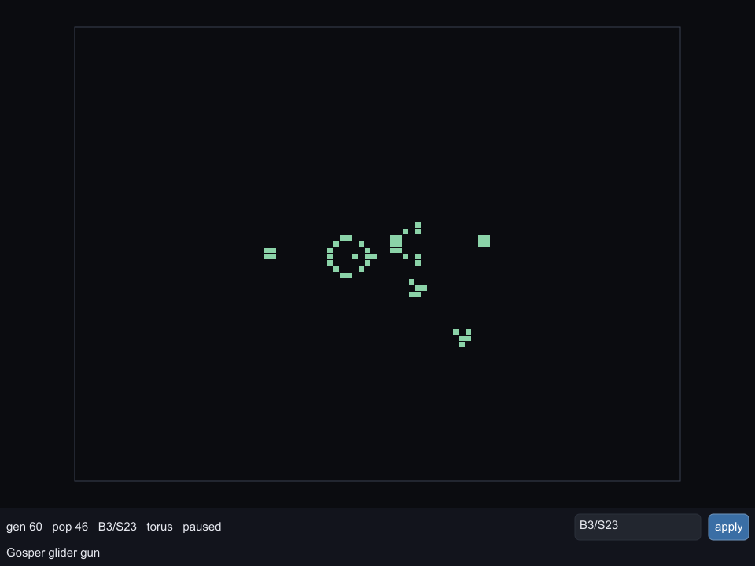

# automata

Life-like cellular automata in [sysl](https://github.com/sysl-lang/sysl): a bit-packed grid that steps
64 cells per machine word, any rule written in B/S notation, RLE patterns, and a
[syslUI](https://github.com/sysl-lang/syslui) viewer.



```
sysl run .
sysl run . -- --rule B36/S23 --pattern 1
sysl run . -- --pattern my-pattern.rle --size 400x300 --bounded
sysl run . -- --shot shot.png --size 96x72 --generations 60
```

## The engine

A row is as many `u64` words as its width needs, one cell per bit. A step never looks at one cell: the
eight neighbours of a word's 64 cells are eight words (the rows above, below and the row itself, each
shifted one place either way, with the bit that crosses a word boundary carried in), summed by
bit-sliced addition into four words holding a 4-bit count per cell. Comparing those counts with the
rule's birth and survival sets is a few ANDs per count.

Edges are a **torus** (the grid wraps) or **bounded** (dead cells beyond the edge that stay dead), and
any width works, not only multiples of 64: the bits past the width are kept at zero.

The tests hold a naive cell-by-cell step as the oracle, and the fast step must agree with it bit for
bit on random grids under six rules, six widths (1, 5, 63, 64, 65, 130) and both edge modes.

## Rules

A rule is a value, parsed from B/S notation wherever it comes from: `--rule`, the `rule =` field of an
RLE header, or the field under the board. `B3/S23`, `S23/B3` and the older `23/3` all read as Life;
`B2/S` (Seeds) has an empty half. A rule that does not read is refused with a diagnostic pointing at
the character that broke it, on stderr from the command line and in the status area in the viewer.
Isotropic non-totalistic notation (`B2a/S12`) is recognised and refused by name.

## Patterns

RLE as Golly and LifeWiki write it: `#` lines (`#N` names the pattern), the `x = , y = , rule =`
header, runs of `b` and `o`, `$` and `!`. The reader is built on
[`parsing`](https://github.com/sysl-lang/parsing). Five patterns are bundled: glider, R-pentomino,
acorn, Gosper glider gun and pulsar.

## The viewer

| input | does |
|---|---|
| drag | pan |
| wheel | zoom about the pointer |
| click | toggle a cell |
| space | run / pause |
| `n` | one generation |
| `+` / `-` | faster / slower |
| `r` / `c` | random fill / clear |
| `t` | torus / bounded |
| `1`–`4` | Life, HighLife, Seeds, Day & Night |
| `5`–`9` | the bundled patterns |
| the rule field, then Return or **apply** | run a typed rule |

`--shot <png>` opens no window: it runs the pattern for `--generations` (default 100), lays out and
rasterizes one frame into a PlutoVG surface, and writes it out.

## Tests

```
sysl test .
```

## Licence

ISC — see `LICENSE`.
